# Common Utilities & Frameworks

A collection of **reusable libraries, tools, and utilities** for WPF, data handling, math, rendering, debugging, and more.  
Organized into modular projects that can be used independently or combined.

---

## General Utilities

- **Weaver / Lector** – Lightweight C# command engines for scripting and runtime execution.
  - **Weaver** is the new interpreter, replacing the legacy Interpreter engine. Which is it's own sub Project see: https://github.com/LoneWandererProductions/Lector
  - **Lector** is the CommandLine integration of Weaver, providing CLI command execution and script parsing.
  - Supports namespaces, extensions, interactive feedback, command registration, structured scripts, loops, conditionals, variables, and debugging.

- **Custom Controls** – Reusable WPF UI components (forms, trees, tables, dialogs).
- **Extension Methods** – Helpers for `List<T>`, `Dictionary<K,V>`, and other types.
- **SQLite Extensions & GUI** – Methods and WPF frontend for SQLite browsing and editing.
- **Generic Serializer** – XML-based serialization for complex objects.
- **Fast Lookup Dictionary** – Optimized for high-speed dictionary access.
- **RAM Memory Cache** – Temporary in-memory object storage.
- **Memory Manager** – Experimental custom memory management.
- **Image Manipulation & Comparison** – Filters, transformations, and pixel comparison tools.
- **File Handling Abstraction** – Unified interface for copy, move, delete, metadata, etc.
- **CSV Reader/Writer** – Simple serialization and I/O utility.
- **Vector Graphics Implementation** – Basic rendering of vector shapes and paths.
- **3D Projection Tools** – Experimental 3D projection and transformation.
- **Debugging & Logging Framework** – Structured logging with optional UI integration.
- **Win32k Wrappers** – Access low-level system features like registry and native dialogs.
- **Plugin Interface** – Loading/unloading and discovery support for plugins.
- **Pathfinder** – Grid-based A* pathfinding for turn-based maps.
- **Dialogs** – Prebuilt SQL login, folder pickers, and confirmation dialogs.

---

## Math Utilities

- **Matrix Calculations** – Addition, multiplication, inversion, etc.
- **3D Vector Calculations** – Vector math for rendering, physics, and pathfinding.
- **Fractals** – Procedural fractal generation tools.
- **Statistics** – Mean, median, variance, and basic analysis.

---

## Coding & Framework Tools

- **Resource String Generator** – Strongly typed classes from raw resource files.
- **In-Memory Logger (`CoreMemoryLog`)** – Runtime log capture without disk I/O.
- **Simple Dependency Injection** – Lightweight DI container.
- **Worker Service Framework** – Abstraction for background threads and long-running jobs.

---

## Highlighted Modules

### Debugger

Flexible **log inspection and debugging framework**.

- Defines `ILogSource` abstraction for plug-and-play log providers.
- Supports event-driven log streaming (`LineReceived`) for real-time UI updates.
- Includes adapters like `InMemoryLogSource` to visualize `CoreMemoryLog`.

**Example:**
```csharp
var source = new InMemoryLogSource(logger);
source.LineReceived += (_, line) => Console.WriteLine(line);
source.Start();
```

---

### CoreMemoryLog

**Lightweight, structured, in-memory logger** for diagnostics.

- Rolling buffer of log entries (timestamp, level, caller, optional exception).
- Can integrate with `Debugger` UI or be used directly in tests.

**Example:**
```csharp
var logger = new InMemoryLogger();
logger.Log(LogLevel.Info, "Starting job {0}", jobId);

foreach (var entry in logger.GetLogs())
    Console.WriteLine($"{entry.Timestamp}: {entry.Message}");
```

---

### CoreBuilder & Code Analyzer

**Scriptable code analyzers and developer utilities**, fully integrated with **Weaver**.

- Detect unused code, formatting issues, missing comments, allocations, etc.
- Utilities for header extraction, license blocks, and string resources.
- Lightweight API exploration (reflection metadata).
- Filesystem utilities (directory size, complexity checks).

**Integration:** Can be executed from:
- GUI via **CoreViewer**
- CLI using **Weaver command engine**
- Scripts inside **Weaver Script Engine**

**Supporting Projects:**
- **CoreViewer** – GUI for visualizing analysis results.
- **CommonDialogs** – File/folder pickers and confirmation prompts.
- **ViewModel** – MVVM bindings for GUI interactions.

---

## Project Overview
Module                         | Purpose / Description                                           | 
------------------------------ | --------------------------------------------------------------- | 
Common.Controls                | WPF custom controls                                             | 
Common.Converter               | WPF/XAML value converters for UI data binding                   | 
Common.Dialogs                 | Prebuilt WPF dialog windows                                     | 
Common.ExtendedObject.Tests    | Unit tests for Extended.Objects and unmanaged memory structures | 
Common.Images                  | WPF custom controls for image display and manipulation          | 
CommonFilter                   | WPF control to filter data tables                               | 
CommonLibrary.Tests            | Unit tests for common utility libraries                         | 
CommonLibraryGui.Tests         | GUI testing for common WPF components                           | 
CommonLibrarySqlLite.Tests     | Tests for SQLite-related features and abstractions              | 
Communication                  | Networking, socket, and web service helpers                     | 
Communication.Tests            | Unit tests for communication and network features               | 
Contracts                      | Shared interfaces and cross-cutting abstractions                | 
Core.Apps                      | Built-in command modules and applications for Weaver            | 
Core.Inject                    | Minimal dependency injection / IoC container support            | 
Core.MemoryLog                 | In-memory structured logger, UI-ready and thread-safe           | 
Core.StateExecutive            | Experimental state machine and fluent engine execution          | 
Core.StateExecutive.Builder    | Fluent builder for configuring StateExecutive execution flows   | 
Core.StateExecutive.Interfaces | Interfaces and contracts for StateExecutive                     | 
Core.Tests                     | Unit tests for core infrastructure and StateExecutive           | 
Core.Viewer                    | WPF GUI frontend and visual shell for Core apps                 | 
CoreBuilder                    | Utilities and helper tools for Weaver engine development        | 
DataFormatter                  | CSV reading/writing and structured data formatting              | 
Debugger                       | Debugging framework and log viewer integration                  | 
Extended.Extensions            | Extension methods for base .NET types and collections           | 
Extended.Objects               | Custom data structures and extended system object types         | 
Extended.Unmanaged             | Unmanaged memory allocation, native buffers, and pointers       | 
FileHandler                    | File system abstraction and I/O utilities                       | 
Imaging                        | Image processing and manipulation tools                         | 
Imaging.Cifs                   | Parser and serializer for CIFS custom image format              | 
Imaging.Compare                | Pixel-based image comparison utility                            | 
Imaging.Filter.Tests           | Unit tests for image filters and algorithms                     | 
Imaging.Objects                | Domain models, pixel buffers, and color primitives              | 
Imaging.Objects.Tests          | Unit tests for Imaging.Objects primitives                       | 
Imaging.Plugins                | Image manipulation plugins and custom filters                   | 
Imaging.Plugins.Interface      | Plugin interfaces and contracts for extensible imaging          | 
Imaging.Tests                  | Unit tests for imaging library and processing pipeline          | 
Imaging.Texture                | 2D/3D texture mapping, tiling, and sprite management            | 
Imaging.Texture.Tests          | Unit tests for texture structures and operations                | 
InterOp                        | Windows API P/Invoke bindings and native interop                | 
Lector                         | CLI integration and console runner for Weaver                   | 
LightVector                    | Lightweight vector math tools                                   | 
Loader                         | Generic plugin loading via interface                            | 
Mathematics                    | Math utilities and calculation libraries                        | 
Mathematics.Constants          | Mathematical and scientific constants                           | 
Pathfinder                     | A\* pathfinding for grid-based maps                             | 
Plugin                         | Base plugin interfaces and lifecycle contracts                  | 
PluginLoader                   | Dynamic plugin loading and MVVM lifecycle management            | 
RenderEngine                   | Experimental 2D/3D rendering backend                            | 
RenderEngine.Tests             | Rendering-related unit and integration tests                    | 
Serializer                     | XML serialization of data and complex structures                | 
Solaris                        | 2D chessboard-style tile renderer                               | 
SQLiteGui                      | UI frontend for SQLiteHelper                                    | 
SQLiteHelper                   | SQLite database interaction and abstraction layer               | 
ViewModel                      | ViewModel base classes and WPF MVVM binding support             | 
Weaver                         | Command interpreter replacing legacy scripting                  | 

```mermaid
graph TD
    Common_Controls["Common.Controls"] --> Extended_Extensions["Extended.Extensions"]
    Common_Controls["Common.Controls"] --> Extended_Objects["Extended.Objects"]
    Common_Controls["Common.Controls"] --> ViewModel["ViewModel"]
    Common_Dialogs["Common.Dialogs"] --> ViewModel["ViewModel"]
    Common_ExtendedObject_Tests["Common.ExtendedObject.Tests"] --> Extended_Objects["Extended.Objects"]
    Common_ExtendedObject_Tests["Common.ExtendedObject.Tests"] --> Extended_Unmanaged["Extended.Unmanaged"]
    Common_ExtendedObject_Tests["Common.ExtendedObject.Tests"] --> Mathematics["Mathematics"]
    Common_Images["Common.Images"] --> Common_Converter["Common.Converter"]
    Common_Images["Common.Images"] --> Common_Dialogs["Common.Dialogs"]
    Common_Images["Common.Images"] --> Imaging_Cifs["Imaging.Cifs"]
    Common_Images["Common.Images"] --> Imaging["Imaging"]
    CommonFilter["CommonFilter"] --> ViewModel["ViewModel"]
    CommonLibrary_Tests["CommonLibrary.Tests"] --> CommonFilter["CommonFilter"]
    CommonLibrary_Tests["CommonLibrary.Tests"] --> Core_MemoryLog["Core.MemoryLog"]
    CommonLibrary_Tests["CommonLibrary.Tests"] --> Extended_Objects["Extended.Objects"]
    CommonLibrary_Tests["CommonLibrary.Tests"] --> FileHandler["FileHandler"]
    CommonLibrary_Tests["CommonLibrary.Tests"] --> InterOp["InterOp"]
    CommonLibrary_Tests["CommonLibrary.Tests"] --> LightVector["LightVector"]
    CommonLibrary_Tests["CommonLibrary.Tests"] --> Mathematics_Constants["Mathematics.Constants"]
    CommonLibrary_Tests["CommonLibrary.Tests"] --> Mathematics["Mathematics"]
    CommonLibrary_Tests["CommonLibrary.Tests"] --> Pathfinder["Pathfinder"]
    CommonLibrary_Tests["CommonLibrary.Tests"] --> Serializer["Serializer"]
    CommonLibrary_Tests["CommonLibrary.Tests"] --> SqliteHelper["SqliteHelper"]
    CommonLibraryGui_Tests["CommonLibraryGui.Tests"] --> Common_Controls["Common.Controls"]
    CommonLibraryGui_Tests["CommonLibraryGui.Tests"] --> Common_Dialogs["Common.Dialogs"]
    CommonLibraryGui_Tests["CommonLibraryGui.Tests"] --> Common_Images["Common.Images"]
    CommonLibraryGui_Tests["CommonLibraryGui.Tests"] --> CommonFilter["CommonFilter"]
    CommonLibraryGui_Tests["CommonLibraryGui.Tests"] --> Imaging_Cifs["Imaging.Cifs"]
    CommonLibraryGui_Tests["CommonLibraryGui.Tests"] --> Imaging_Compare["Imaging.Compare"]
    CommonLibraryGui_Tests["CommonLibraryGui.Tests"] --> InterOp["InterOp"]
    CommonLibraryGui_Tests["CommonLibraryGui.Tests"] --> LightVector["LightVector"]
    CommonLibraryGui_Tests["CommonLibraryGui.Tests"] --> Solaris["Solaris"]
    CommonLibrarySqlLite_Tests["CommonLibrarySqlLite.Tests"] --> SqliteHelper["SqliteHelper"]
    Communication_Tests["Communication.Tests"] --> Communication["Communication"]
    Core_Apps["Core.Apps"] --> Weaver["Weaver"]
    Core_StateExecutive["Core.StateExecutive"] --> Core_StateExecutive_Interfaces["Core.StateExecutive.Interfaces"]
    Core_StateExecutive_Builder["Core.StateExecutive.Builder"] --> Core_StateExecutive_Interfaces["Core.StateExecutive.Interfaces"]
    Core_StateExecutive_Builder["Core.StateExecutive.Builder"] --> Extended_Extensions["Extended.Extensions"]
    Core_Tests["Core.Tests"] --> Contracts["Contracts"]
    Core_Tests["Core.Tests"] --> Core_Apps["Core.Apps"]
    Core_Tests["Core.Tests"] --> Core_Inject["Core.Inject"]
    Core_Tests["Core.Tests"] --> Core_MemoryLog["Core.MemoryLog"]
    Core_Tests["Core.Tests"] --> Core_StateExecutive_Builder["Core.StateExecutive.Builder"]
    Core_Tests["Core.Tests"] --> Core_StateExecutive_Interfaces["Core.StateExecutive.Interfaces"]
    Core_Tests["Core.Tests"] --> Core_StateExecutive["Core.StateExecutive"]
    Core_Viewer["Core.Viewer"] --> Common_Converter["Common.Converter"]
    Core_Viewer["Core.Viewer"] --> Common_Dialogs["Common.Dialogs"]
    Core_Viewer["Core.Viewer"] --> Core_Apps["Core.Apps"]
    Core_Viewer["Core.Viewer"] --> ViewModel["ViewModel"]
    Debugger["Debugger"] --> Common_Dialogs["Common.Dialogs"]
    Debugger["Debugger"] --> Common_Images["Common.Images"]
    Debugger["Debugger"] --> CommonFilter["CommonFilter"]
    Debugger["Debugger"] --> Core_MemoryLog["Core.MemoryLog"]
    Extended_Objects["Extended.Objects"] --> Extended_Unmanaged["Extended.Unmanaged"]
    Imaging["Imaging"] --> Extended_Extensions["Extended.Extensions"]
    Imaging["Imaging"] --> Imaging_Objects["Imaging.Objects"]
    Imaging["Imaging"] --> Imaging_Plugins_Interface["Imaging.Plugins.Interface"]
    Imaging["Imaging"] --> Imaging_Texture["Imaging.Texture"]
    Imaging["Imaging"] --> Mathematics_Constants["Mathematics.Constants"]
    Imaging_Cifs["Imaging.Cifs"] --> DataFormatter["DataFormatter"]
    Imaging_Cifs["Imaging.Cifs"] --> Extended_Objects["Extended.Objects"]
    Imaging_Cifs["Imaging.Cifs"] --> Imaging["Imaging"]
    Imaging_Compare["Imaging.Compare"] --> FileHandler["FileHandler"]
    Imaging_Compare["Imaging.Compare"] --> Imaging_Objects["Imaging.Objects"]
    Imaging_Compare["Imaging.Compare"] --> Imaging["Imaging"]
    Imaging_Filter_Tests["Imaging.Filter.Tests"] --> Imaging["Imaging"]
    Imaging_Objects_Tests["Imaging.Objects.Tests"] --> Imaging_Objects["Imaging.Objects"]
    Imaging_Plugins["Imaging.Plugins"] --> Imaging_Plugins_Interface["Imaging.Plugins.Interface"]
    Imaging_Tests["Imaging.Tests"] --> FileHandler["FileHandler"]
    Imaging_Tests["Imaging.Tests"] --> Imaging_Cifs["Imaging.Cifs"]
    Imaging_Tests["Imaging.Tests"] --> Imaging_Compare["Imaging.Compare"]
    Imaging_Tests["Imaging.Tests"] --> Imaging["Imaging"]
    Imaging_Tests["Imaging.Tests"] --> Mathematics["Mathematics"]
    Imaging_Texture_Tests["Imaging.Texture.Tests"] --> Imaging_Texture["Imaging.Texture"]
    Imaging_Texture_Tests["Imaging.Texture.Tests"] --> Imaging["Imaging"]
    Lector["Lector"] --> Core_Apps["Core.Apps"]
    Lector["Lector"] --> Weaver["Weaver"]
    LightVector["LightVector"] --> DataFormatter["DataFormatter"]
    LightVector["LightVector"] --> Mathematics["Mathematics"]
    Mathematics["Mathematics"] --> DataFormatter["DataFormatter"]
    Mathematics["Mathematics"] --> Extended_Extensions["Extended.Extensions"]
    PluginLoader["PluginLoader"] --> Plugin["Plugin"]
    PluginLoader["PluginLoader"] --> ViewModel["ViewModel"]
    RenderEngine["RenderEngine"] --> Extended_Unmanaged["Extended.Unmanaged"]
    RenderEngine["RenderEngine"] --> Imaging_Objects["Imaging.Objects"]
    RenderEngine["RenderEngine"] --> Imaging_Texture["Imaging.Texture"]
    RenderEngine_Tests["RenderEngine.Tests"] --> RenderEngine["RenderEngine"]
    Solaris["Solaris"] --> Extended_Extensions["Extended.Extensions"]
    Solaris["Solaris"] --> Imaging_Objects["Imaging.Objects"]
    Solaris["Solaris"] --> Imaging_Texture["Imaging.Texture"]
    SQLiteGui["SQLiteGui"] --> Contracts["Contracts"]
    SQLiteGui["SQLiteGui"] --> DataFormatter["DataFormatter"]
    SQLiteGui["SQLiteGui"] --> SqliteHelper["SqliteHelper"]
    SQLiteGui["SQLiteGui"] --> ViewModel["ViewModel"]
    SQLiteHelper["SQLiteHelper"] --> Core_MemoryLog["Core.MemoryLog"]
    Weaver["Weaver"] --> Loader["Loader"]
```


